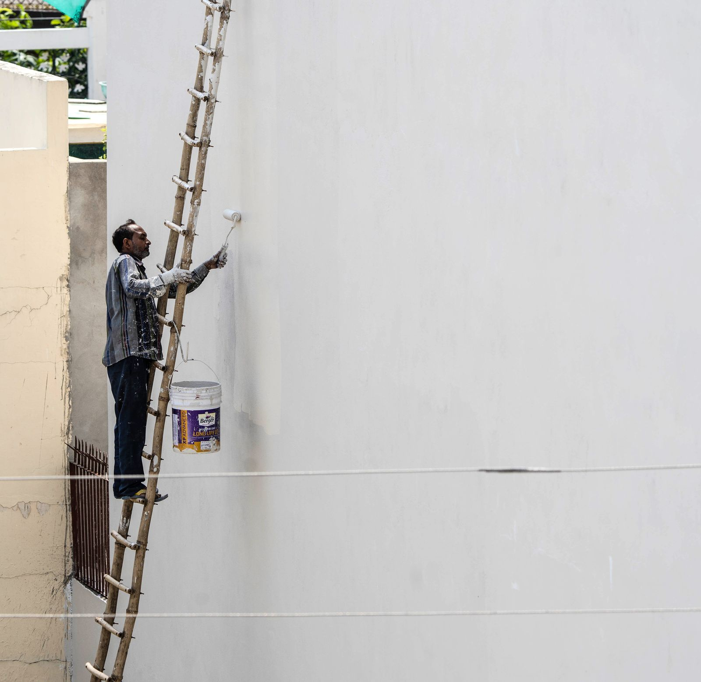

Everybody wants their house painted in June. June is not the best month. That is not a scheduling
excuse, it is what the climate record actually says, and if you plan around it you get a better job
and an easier crew to book.

Here is the honest version of exterior painting in this climate, with the weather data in front of it
instead of behind it.

## The window is defined by the overnight low, not the afternoon high

This is the part homeowners consistently get wrong. You look outside at two in the afternoon in
April, it is 60 degrees and sunny, and it seems like a fine day to paint. But a paint film keeps
forming long after the crew drives away. What happens to the wall at 4 a.m. matters as much as what
happened at 2 p.m.

So look at the record for the low, not the high. This is Chicago Midway, the reporting station
closest to the southwest suburbs, using NOAA's 1991 to 2020 climate normals.

<figure class="chart">
<svg viewBox="0 0 720 380" role="img" aria-labelledby="p3t p3d" style="width:100%;max-width:720px;height:auto">
  <title id="p3t">Chicago Midway monthly normal high and low temperatures, with wet days</title>
  <desc id="p3d">Each bar spans the normal daily low to the normal daily high for that month. Normal overnight lows are above 50 degrees only from May through September. The small bars underneath show the average number of days per month with at least a tenth of an inch of precipitation, which peaks in May and June at 8.2 and 8.0 days.</desc>
  <g font-family="system-ui, sans-serif" fill="currentColor">
    <text x="0" y="16" font-size="13" opacity="0.75">Normal daily low to normal daily high, F. Chicago Midway, NOAA 1991 to 2020 normals.</text>

    <line x1="55" y1="150" x2="700" y2="150" stroke="#c0392b" stroke-width="1.5" stroke-dasharray="5 4"></line>
    <text x="0" y="147" font-size="12" fill="#c0392b">50 F</text>
    <line x1="55" y1="95" x2="700" y2="95" stroke="currentColor" stroke-width="1" opacity="0.18"></line>
    <text x="0" y="99" font-size="11" opacity="0.6">70 F</text>
    <line x1="55" y1="205" x2="700" y2="205" stroke="currentColor" stroke-width="1" opacity="0.18"></line>
    <text x="0" y="209" font-size="11" opacity="0.6">30 F</text>

    <rect x="74"  y="198" width="26" height="37" fill="#9aa3ad"></rect>
    <rect x="127" y="186" width="26" height="39" fill="#9aa3ad"></rect>
    <rect x="180" y="157" width="26" height="44" fill="#9aa3ad"></rect>
    <rect x="234" y="123" width="26" height="51" fill="#1f5fa9"></rect>
    <rect x="287" y="92"  width="26" height="53" fill="#2e7d4f"></rect>
    <rect x="340" y="65"  width="26" height="51" fill="#2e7d4f"></rect>
    <rect x="394" y="54"  width="26" height="47" fill="#2e7d4f"></rect>
    <rect x="447" y="60"  width="26" height="45" fill="#2e7d4f"></rect>
    <rect x="500" y="78"  width="26" height="48" fill="#2e7d4f"></rect>
    <rect x="554" y="113" width="26" height="47" fill="#1f5fa9"></rect>
    <rect x="607" y="153" width="26" height="39" fill="#9aa3ad"></rect>
    <rect x="660" y="184" width="26" height="35" fill="#9aa3ad"></rect>

    <g font-size="11" text-anchor="middle" opacity="0.85">
      <text x="87" y="252">Jan</text><text x="140" y="252">Feb</text><text x="193" y="252">Mar</text>
      <text x="247" y="252">Apr</text><text x="300" y="252">May</text><text x="353" y="252">Jun</text>
      <text x="407" y="252">Jul</text><text x="460" y="252">Aug</text><text x="513" y="252">Sep</text>
      <text x="567" y="252">Oct</text><text x="620" y="252">Nov</text><text x="673" y="252">Dec</text>
    </g>

    <text x="0" y="286" font-size="12" opacity="0.75">Days per month with 0.10 in. or more of precipitation</text>
    <line x1="55" y1="320" x2="700" y2="320" stroke="currentColor" stroke-width="1" opacity="0.35"></line>
    <rect x="74"  y="310" width="26" height="10" fill="#1f5fa9" opacity="0.55"></rect>
    <rect x="127" y="310" width="26" height="10" fill="#1f5fa9" opacity="0.55"></rect>
    <rect x="180" y="305" width="26" height="15" fill="#1f5fa9" opacity="0.55"></rect>
    <rect x="234" y="299" width="26" height="21" fill="#1f5fa9" opacity="0.55"></rect>
    <rect x="287" y="295" width="26" height="25" fill="#1f5fa9" opacity="0.55"></rect>
    <rect x="340" y="296" width="26" height="24" fill="#1f5fa9" opacity="0.55"></rect>
    <rect x="394" y="304" width="26" height="16" fill="#1f5fa9" opacity="0.55"></rect>
    <rect x="447" y="301" width="26" height="19" fill="#1f5fa9" opacity="0.55"></rect>
    <rect x="500" y="304" width="26" height="16" fill="#1f5fa9" opacity="0.55"></rect>
    <rect x="554" y="301" width="26" height="19" fill="#1f5fa9" opacity="0.55"></rect>
    <rect x="607" y="306" width="26" height="14" fill="#1f5fa9" opacity="0.55"></rect>
    <rect x="660" y="307" width="26" height="13" fill="#1f5fa9" opacity="0.55"></rect>
    <g font-size="10" text-anchor="middle" opacity="0.8">
      <text x="87" y="334">3.4</text><text x="140" y="334">3.4</text><text x="193" y="334">5.0</text>
      <text x="247" y="334">6.9</text><text x="300" y="334">8.2</text><text x="353" y="334">8.0</text>
      <text x="407" y="334">5.5</text><text x="460" y="334">6.4</text><text x="513" y="334">5.4</text>
      <text x="567" y="334">6.3</text><text x="620" y="334">4.7</text><text x="673" y="334">4.3</text>
    </g>
    <text x="0" y="362" font-size="11" opacity="0.65">Green: normal overnight low above 50 F. Blue: shoulder month. Gray: normal low below freezing or near it.</text>
  </g>
</svg>
<figcaption>Chicago Midway (station USW00014819), NOAA U.S. Climate Normals, 1991 to 2020. The 50 F line is a reference line, not a product specification. Every exterior coating prints its own minimum air and surface temperature on the label and they are not all the same number.</figcaption>
</figure>

Here is the same data as a table, because the numbers matter more than the picture.

| Month | Normal high | Normal low | Precipitation | Days with 0.10 in. or more |
|---|---:|---:|---:|---:|
| March | 47.6 | 31.7 | 1.88 in | 5.0 |
| April | 59.9 | 41.4 | 3.57 in | 6.9 |
| May | 71.1 | 52.0 | 4.09 in | 8.2 |
| June | 80.9 | 62.3 | 4.01 in | 8.0 |
| July | 85.0 | 67.7 | 3.55 in | 5.5 |
| August | 82.7 | 66.4 | 3.99 in | 6.4 |
| September | 76.3 | 58.8 | 2.77 in | 5.4 |
| October | 63.4 | 46.5 | 3.48 in | 6.3 |
| November | 49.1 | 35.0 | 2.35 in | 4.7 |

Source: NOAA National Centers for Environmental Information, U.S. Climate Normals 1991 to 2020,
Chicago Midway.

Three things fall out of that table immediately.

**One. The normal overnight low clears 50 degrees in May and drops back under it in October.** The
real working season is roughly May through September, with April and October as shoulder months that
depend entirely on the week you get. That is five solid months, not eight.

**Two. May and June are the two wettest months by wet-day count.** 8.2 and 8.0 days with at least a
tenth of an inch. Those are exactly the months everybody calls to book. A wet day is not just a lost
day, it is a lost day plus dry-out time on the siding before anyone can coat it.

**Three, and this is the useful one. September is the best exterior month in this climate and almost
nobody asks for it.** Normal low still 58.8 degrees, normal high 76.3, and 2.77 inches of rain across
5.4 wet days, which is the driest month of the entire warm season. Warm enough, dry enough, and out
of the ninety-plus heat that causes its own problems.

## Heat and direct sun are a real problem, not a bonus

There is a persistent idea that the hotter and sunnier it is, the better paint dries. The technical
literature says otherwise.

The National Park Service brief on exterior paint failure describes solvent blistering this way: "If
solvent-rich paint is applied in direct sunlight, the top surface can dry too quickly and, as a
result, solvents become trapped beneath the dried paint film." When the solvent later vaporizes, it
pushes through and blisters the surface. The brief notes this "occurs more often with dark colored
paints because darker colors absorb more heat than lighter ones," and its recommendation is direct:
"paint should not be applied in direct sunlight."

The same document lists four causes of wrinkling, and one of them is "painting in temperatures higher
than recommended by the manufacturer."

**What that means on your house:** a crew should be chasing shade around the building through the
day. South and west elevations in the afternoon in July are the wrong place to be working. If someone
is spraying your dark south wall at 2 p.m. in a heat wave, that is a decision, and not a good one.

## Before any of that: find the water

This is the single most important paragraph in the post, and it is the one people skip.

The NPS brief on peeling to bare wood is unambiguous: "There is no sense in repainting before dealing
with the moisture problems because new paint will simply fail."

It then lists what to correct before repainting: "faulty flashing; leaking gutters; defective roof
shingles; cracks and holes in siding and trim; deteriorated caulking in joints and seams; and
shrubbery growing too close to painted wood."

Read that list against your own house. Gutters that overflow at the corner. The bush that has been
touching the garage wall for six years. The caulk joint at the window that opened up two winters ago.
Those are the reason the paint failed there and not somewhere else, and painting over them buys you
two seasons.

<figure>
  
  <figcaption>Exterior work is access work as much as it is paint work, and access is most of what separates a one story quote from a two story quote. Stock photo, to be replaced with our own job photos.</figcaption>
</figure>

## Chalk: the ten second test that predicts whether the job will fail

Old exterior paint powders as it ages. In moderation that is normal and even helpful. In excess it is
a bonding problem, because as the brief puts it, "if latex paint is applied over old, chalking oil
paint, peeling can also occur because the latex paint is unable to penetrate the chalky surface and
adhere."

Test it yourself. Rub a dark cloth or your palm firmly across the siding. If it comes back coated in
a chalky film, that surface needs washing before it needs painting. The brief's cleaning
recommendation is a solution of half a cup of household detergent to one gallon of water, scrubbed
with a medium soft brush, then rinsed with a direct stream from a hose and allowed to dry thoroughly.

That is a labor day, and it is not optional on a chalked house. Any quote that does not mention
washing on an older aluminum-sided or wood-sided house in this area has skipped a step you will pay
for later.

## How long it should last, and what makes the difference

| Source | Stated service life |
|---|---|
| National Park Service, exterior wood | Re-application every 5 to 8 years |
| This Old House, properly applied exterior job | 5 to 10 years |
| This Old House, standard latex | About 5 to 7 years, depending on exposure |
| This Old House, premium acrylic | 8 to 12 years or longer |

The gap between the bottom of that range and the top is roughly double the service life for what is
maybe a 20 to 30 percent difference in material cost. That is the clearest argument in the whole
trade for buying the better product, and it is not a sales line, it is arithmetic on published
numbers.

Also worth knowing: paint film has a ceiling. From the NPS brief, when accumulated paint reaches
about 1/16 of an inch, roughly 16 to 30 layers, "one or more extra coats of paint may be enough to
trigger cracking and peeling." Thick paint fails at its oldest layer. On a 1965 house that has been
repainted every eight years, that is not a theoretical concern.

## What exteriors cost, and why stories matter more than square feet

| Home | Published range |
|---|---|
| Per square foot, overall | $2.20 to $4.40 |
| One story, 2,000 sq ft | $4,400 to $8,800 |
| Two stories, 2,000 sq ft | $6,900 to $12,700 |
| Three stories, 2,000 sq ft | $8,300 to $15,200 |

| Siding | Per square foot |
|---|---|
| Wood | $1.70 to $3.60 |
| Aluminum | $2.10 to $4.20 |
| Stucco | $2.50 to $4.80 |
| Brick | $2.60 to $5.00 |
| Vinyl | $2.80 to $5.20 |

| Detail work | Rate |
|---|---|
| Trim | $4.25 to $8.25 per linear foot |
| Fascia | $4.50 to $8.50 per linear foot |
| Exterior doors | $165 to $330 each |

Source: This Old House, cost to paint house exterior. These are published national market ranges, not
our prices. We quote your house after walking it.

Notice that going from one story to two adds more to the published low end than the entire spread of
most siding choices. Height is access, access is staging and time, and it is the biggest single
driver on the outside of a house.

**One local note on brick.** A lot of housing stock in Bridgeview, Oak Lawn, Burbank and Worth is
brick or part brick. Painting brick is close to a permanent decision, because getting paint back off
masonry is difficult, expensive and can damage the face of the brick. That is our judgment rather
than a published statistic, but it is worth hearing before you commit. If the brick is sound, the
higher-leverage job is usually trim, soffit, fascia, gutters, garage door and the front door, which
changes the look of the house for a fraction of the money.

## The scheduling argument, stated plainly

Here is how the calendar actually works in this trade. Every homeowner decides in April that they
want the house painted. Every painter's May and June fill up in about three weeks. The market's own
cost data notes that pros are busiest in spring and that fall work therefore tends to be cheaper for
the customer.

So:

| If you want | Call by |
|---|---|
| May or June work | February or early March |
| July or August work | April |
| September, the best month in the data | June or July |
| October shoulder work | August, and accept weather risk |

Calling in June for June work means you get whoever is available in June, which is not the same
population as whoever is good.

## The short version

- The exterior season here is roughly May through September, set by the overnight low.
- May and June are the two wettest months by wet-day count, and they are the two everybody books.
- September has the lowest warm-season rainfall and lows still near 59 degrees. It is the best month
  and it is the easiest to book.
- Direct sun and high heat cause blistering and wrinkling. Chasing shade is a real technique.
- Fix the gutters, flashing, caulk and shrubbery before painting, or the new coat fails where the old
  one did.
- Wash the chalk off, or latex will not stick to it.

We work out of Bridgeview at 7900 W. 83rd St. and we quote exterior work across the southwest
suburbs. If you want on the schedule for a good week rather than whatever week is left, call
**[708-935-4289](tel:+17089354289)**.

More on this: [exterior painting](../exterior-painting.html). Decks and fences run on the same seasonal
clock in a smaller package, so the timing above applies to them too. Related reading:
[how to tell good prep from a fast cheap job](how-to-tell-good-prep-from-a-fast-cheap-job.html) and
[choosing colors that work in older southwest suburb homes](choosing-paint-colors-older-southwest-suburb-homes.html).

## References

1. NOAA National Centers for Environmental Information, U.S. Climate Normals 1991 to 2020, monthly normals for Chicago Midway Airport (station USW00014819), retrieved via the NCEI data access service. https://www.ncei.noaa.gov/products/land-based-station/us-climate-normals
2. National Park Service, Preservation Brief 10: Exterior Paint Problems on Historic Woodwork. https://www.nps.gov/orgs/1739/upload/preservation-brief-10-paint-problems-exterior-woodwork.pdf
3. This Old House, Cost to Paint House Exterior. https://www.thisoldhouse.com/painting/reviews/cost-to-paint-house-exterior
4. Thumbtack, Deck Staining Cost (seasonality of contractor demand). https://www.thumbtack.com/p/deck-staining-cost
5. Thumbtack, Fence Staining Cost. https://www.thumbtack.com/p/fence-staining-cost
6. U.S. Environmental Protection Agency, Lead Renovation, Repair and Painting Program. https://www.epa.gov/lead/lead-renovation-repair-and-painting-program
