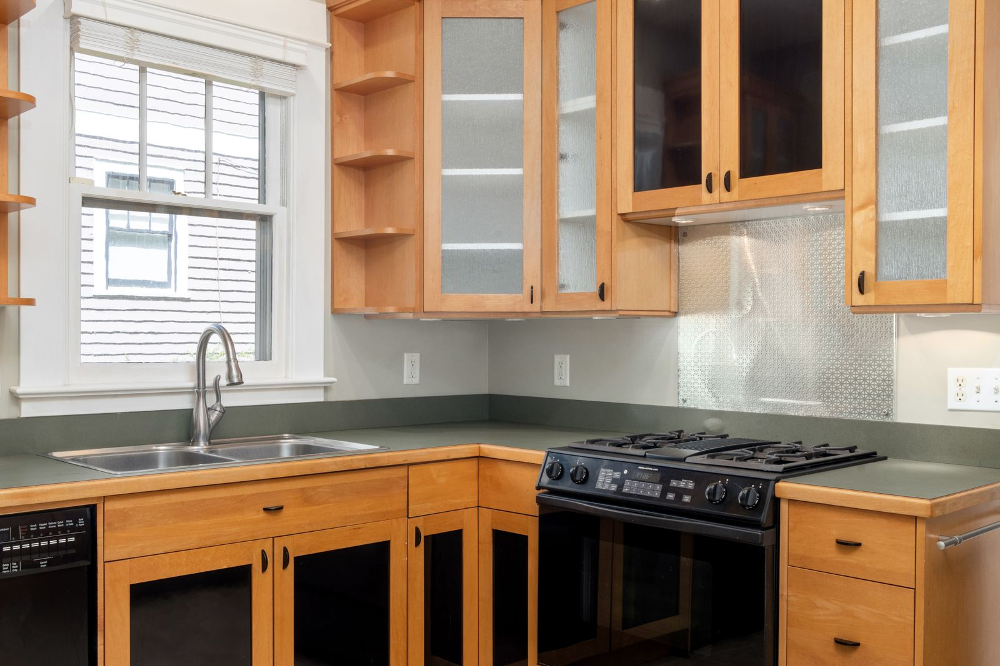

"Is it cheaper to repaint the cabinets or replace them?" is one of the most searched questions in
this trade, and most of the answers online are quietly misleading. Not because the numbers are wrong,
but because the three options are not being measured the same way.

Let us fix that first, then answer the question.

## Three options, and they are not variations of each other

| | What actually changes | What stays |
|---|---|---|
| **Refinish (repaint)** | Color and sheen of the existing doors, drawer fronts and boxes | Layout, boxes, doors, hinges, drawer glides, storage |
| **Reface** | New door and drawer fronts, new veneer on the box faces, usually new hardware | Layout, boxes, interiors, storage |
| **Replace** | Everything, including layout and internal storage if you want it | Nothing, unless you keep the countertop |

If your complaint is "I hate the color," all three fix it and only one of them costs what the fix is
worth. If your complaint is "there is nowhere to put anything and the sink base is rotted," only one
of them fixes it at all.

## What the published numbers actually say

Here is where the online answers go wrong. Watch the labels carefully.

<figure class="chart">
<svg viewBox="0 0 720 300" role="img" aria-labelledby="p4t p4d" style="width:100%;max-width:720px;height:auto">
  <title id="p4t">Published cost ranges for cabinet refinishing, refacing and new cabinet installation labor</title>
  <desc id="p4d">Refinishing a whole kitchen is published at $1,390 to $3,353 with a typical figure of $2,164. Refacing a 20 foot run at mid range pricing is $2,000 to $4,000. The published cabinet refacing project range is $508 to $2,049 with a most common figure of $985. New cabinet installation labor is $388 to $1,802 for standard cabinets and $1,447 to $5,294 for custom, and neither figure includes buying the cabinets.</desc>
  <g font-family="system-ui, sans-serif" fill="currentColor" font-size="12">
    <text x="0" y="16" font-size="13" opacity="0.75">Published market ranges. Not our prices.</text>

    <text x="0" y="52">Refinish, whole kitchen</text>
    <rect x="324" y="47" width="175" height="20" fill="#1f5fa9"></rect>
    <line x1="393" y1="43" x2="393" y2="71" stroke="#ffffff" stroke-width="2"></line>
    <text x="505" y="62" font-size="11">$1,390 to $3,353</text>

    <text x="0" y="94">Reface, 20 ft, mid range</text>
    <rect x="378" y="89" width="178" height="20" fill="#2e7d4f"></rect>
    <text x="562" y="104" font-size="11">$2,000 to $4,000</text>

    <text x="0" y="136">Reface, project range</text>
    <rect x="245" y="131" width="137" height="20" fill="#2e7d4f" opacity="0.6"></rect>
    <line x1="288" y1="127" x2="288" y2="155" stroke="#ffffff" stroke-width="2"></line>
    <text x="388" y="146" font-size="11">$508 to $2,049</text>

    <text x="0" y="178">Install new, labor only</text>
    <rect x="235" y="173" width="126" height="20" fill="#c0392b" opacity="0.75"></rect>
    <text x="367" y="188" font-size="11">$388 to $1,802 (cabinets NOT included)</text>

    <text x="0" y="220">Install custom, labor only</text>
    <rect x="329" y="215" width="343" height="20" fill="#c0392b"></rect>
    <text x="329" y="250" font-size="11">$1,447 to $5,294 (cabinets NOT included)</text>

    <line x1="200" y1="262" x2="690" y2="262" stroke="currentColor" stroke-width="1" opacity="0.35"></line>
    <g font-size="11" opacity="0.7" text-anchor="middle">
      <text x="200" y="278">$0</text><text x="289" y="278">$1k</text><text x="378" y="278">$2k</text>
      <text x="467" y="278">$3k</text><text x="556" y="278">$4k</text><text x="646" y="278">$5k</text>
    </g>
    <text x="0" y="296" font-size="11" opacity="0.7">White ticks mark the source's most common figure. Sources: Thumbtack cabinet painting, refacing and installation cost pages.</text>
  </g>
</svg>
<figcaption>The two red bars are the trap. Published "cabinet installation" costs are labor only and explicitly exclude buying the cabinets.</figcaption>
</figure>

| Option | Published figure | What the figure includes |
|---|---|---|
| Refinish, whole kitchen | $1,390 to $3,353, typical $2,164 | The work, all in |
| Refinish, per linear foot | $30 to $60 general, $38 sprayed | The work |
| Refinish, per square foot of cabinet face | $3 to $8 | The work |
| Refinish, labor rate | $45 to $55 per hour | The work |
| Reface, per linear foot | $50 to $100 budget, $100 to $300 mid, $300 to $500 premium | Materials and work |
| Reface, 20 foot run at mid range | $2,000 to $4,000 | Materials and work |
| Reface, published project range | $508 to $2,049, most common $985 | Materials and work |
| Reface hardware | Knobs $2 to $4 each, hinges $4 to $20 each | Parts |
| Install new cabinets, standard | $388 to $1,802 | **Labor only. Cabinets not included** |
| Install new cabinets, custom | $1,447 to $5,294 | **Labor only. Cabinets not included** |

Sources: Thumbtack cost to paint kitchen cabinets, This Old House interior painting cost, Thumbtack
cabinet refacing cost, Thumbtack cabinet installation cost.

**That last pair is the whole misunderstanding.** People search "cost to replace kitchen cabinets,"
find a figure around $400 to $1,800, and conclude replacement is cheaper than painting. It is not.
That number is the installer's labor. The cabinets themselves are a separate purchase and they are
the large number.

For the actual order of magnitude on replacement, look at whole-kitchen data instead:

| Kitchen remodel, 144 sq ft | Published figure |
|---|---|
| National average, whole remodel | $28,696 to $90,397 |
| Per square foot | $199 to $628 |
| Materials, L-shaped without island | $17,922 to $43,543 |
| Labor, L-shaped without island | $9,667 to $16,746 |

Source: Thumbtack, kitchen remodel cost. This covers a full remodel, not cabinets alone, because no
source in this set publishes an all-in cabinets-only replacement figure. It is shown here for scale,
not as a cabinet price.

So the honest comparison, stated as plainly as the data allows: **refinishing a kitchen is published
in the low thousands. Refacing is published in the low-to-mid thousands. Replacing cabinets sits
inside a remodel budget that starts near thirty thousand dollars.** Those are different categories of
decision, not three quotes on the same job.

## Timeline

| Option | Published or observable timeline |
|---|---|
| Reface | "about a week, tops" for a professional; a smaller kitchen or bathroom "as little as two days" |
| Refinish | Driven by recoat and cure times on the product, not by brush speed |
| Replace | Part of a remodel schedule, with demolition, possible plumbing and electrical, and countertop templating after install |

Source for the refacing figures: Thumbtack, cabinet refacing cost.

On refinishing, the thing to understand is that **dry time and cure time are two different numbers,
and every cabinet coating publishes both.** Dry to recoat might be hours. Full cure, meaning the
finish is hard enough to take a coffee cup sliding across it and doors closing against each other,
takes considerably longer. Ask which number your completion date is based on, and ask when you can
actually load the cabinets back up. A finish that gets used before it cures is a finish that prints
every fingernail in it for the next ten years.

## Why cabinet work is the part of painting where skill actually shows

<figure>
  
  <figcaption>Sound oak boxes with a finish nobody likes anymore. This is the exact case where refinishing wins, because the expensive part of the kitchen is not the problem. Stock photo, to be replaced with our own job photos.</figcaption>
</figure>

A wall is forgiving. Cabinets are not. They get touched every day, they get wiped with cleaner, they
have doors that close against each other, and they sit at eye level under kitchen lighting.

The sequence that separates a cabinet job that lasts from one that peels in eighteen months:

1. **Doors and drawer fronts come off and get labeled.** Every one goes back exactly where it came
   from. Hinges and screws bagged by location.
2. **Degrease.** Kitchen cabinets carry years of cooking film, especially above the range and around
   the handles. Nothing sticks to grease. This is the single most skipped step.
3. **Deglossing and sanding.** Same principle as any repaint: the surface has to be dull for the next
   coat to key into it. On a factory conversion varnish finish, this matters even more.
4. **Bonding primer, chosen for the substrate.** Oak, maple, thermofoil and laminate are four
   different problems. Oak also needs a decision about whether you fill the grain or let it show.
5. **Finish coats, sprayed if possible.** Sprayed at $38 per linear foot is the published figure for
   a reason. It is what makes cabinets look like cabinets instead of like painted furniture.
6. **Cure before reassembly.** See above.
7. **Rehang, adjust, and add bumpers** so doors are not closing paint against paint.

Note step four. **Not every cabinet can be refinished well.** Thermofoil that is already peeling from
the MDF, water-swollen sink bases, and doors that have delaminated are not candidates. An honest
answer on a walk-through is sometimes "this one is not worth painting," and that is worth hearing
before you pay for it.

## The decision, in three questions

**1. Are the boxes sound?**
Open the sink base. Check the bottom, the back and the corners for water damage and swelling. Pull a
drawer all the way out and look at the glides. If the boxes are solid, the expensive part of your
kitchen is already fine and you are only buying a look. If the boxes are failing, paint on the doors
does not fix a rotted cabinet.

**2. Does the layout work?**
This is the honest test. If you would keep the exact same layout, refinishing or refacing wins on
value by a wide margin. If the real complaint is that there is no pantry, the corner is dead space,
and the range is in the wrong place, then no finish work solves it and you are looking at a remodel.

**3. What are the doors made of?**
Solid wood and quality plywood boxes are excellent refinishing candidates. Thermofoil and laminate
are conditional. Damaged thermofoil is usually a refacing or replacement case.

| Your situation | The answer that fits |
|---|---|
| Solid boxes, layout works, hate the color | **Refinish** |
| Solid boxes, layout works, doors are dated or damaged | **Reface** |
| Solid boxes, want a different look and new hardware, budget is mid | **Reface** |
| Water damage in the boxes, failing glides, sagging shelves | **Replace** |
| Layout genuinely does not work for how you cook | **Replace, as part of a remodel** |
| Thermofoil peeling off the MDF underneath | **Reface or replace, not refinish** |
| Selling the house in the next year | **Refinish**, almost always |

That last line deserves a sentence. If the goal is a kitchen that photographs well for a listing, the
published refinishing range delivers the visible change at a small fraction of a remodel. This is our
opinion on where the value sits, not a published statistic, and we will say so on the walk-through if
we think replacement is the better call for you.

## The short version

- Refinish, reface and replace are three different decisions, not three prices for one job.
- The cheap "replace" figures you find online are installation labor only. The cabinets are extra,
  and they are the big number.
- Published refinishing for a whole kitchen: $1,390 to $3,353, typical $2,164.
- Published refacing for a 20 foot run at mid range pricing: $2,000 to $4,000.
- Sound boxes plus a layout that works means the expensive part of the kitchen is already fine.
- Ask about cure time, not just dry time, and ask when you can load the cabinets back up.

We refinish cabinets across the southwest suburbs from our shop at 7900 W. 83rd St. in Bridgeview. If
you want somebody to open the sink base and tell you honestly which of the three you are looking at,
call **[708-935-4289](tel:+17089354289)**.

More on this: [cabinet painting](../cabinet-refinishing.html) and
[interior painting](../interior-painting.html). Related reading:
[what interior painting costs in the southwest suburbs](interior-painting-cost-southwest-chicago-suburbs.html)
and
[choosing colors that work in older southwest suburb homes](choosing-paint-colors-older-southwest-suburb-homes.html).

## References

1. Thumbtack, Cost to Paint Kitchen Cabinets. https://www.thumbtack.com/p/cost-to-paint-kitchen-cabinets
2. Thumbtack, Cabinet Refacing Cost. https://www.thumbtack.com/p/cabinet-refacing-cost
3. Thumbtack, Cabinet Installation Cost. https://www.thumbtack.com/p/cabinet-installation-cost
4. Thumbtack, Kitchen Remodel Cost. https://www.thumbtack.com/p/kitchen-remodel-cost
5. This Old House, Interior Painting Cost. https://www.thisoldhouse.com/painting/reviews/interior-painting-cost

*All dollar figures above are published national market ranges retrieved on August 31, 2026. They are
not a quote and they are not our prices.*
