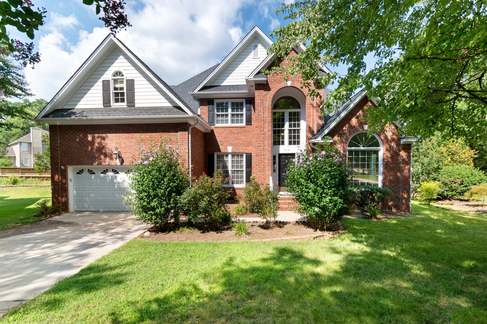

Most color advice on the internet is written for a house that does not exist around here. It assumes
a ten foot ceiling, big windows on two walls, white trim already in place, and no brick.

The houses in Bridgeview, Oak Lawn, Burbank, Worth and Hickory Hills are not that. Here is what they
actually are, from the Census.

| Town | Median year structure built | Median home value |
|---|---:|---:|
| Evergreen Park | 1955 | $255,700 |
| Burbank | 1965 | $258,900 |
| Oak Lawn | 1967 | $267,900 |
| Worth | 1967 | $220,200 |
| Hickory Hills | 1970 | $278,400 |
| Chicago Ridge | 1973 | $217,800 |
| Alsip | 1974 | $208,700 |
| Bridgeview | 1975 | $234,000 |
| Justice | 1976 | $235,200 |
| Palos Hills | 1977 | $259,200 |

Source: U.S. Census Bureau, American Community Survey 5-year estimates 2023, tables B25035 and B25077.

Every median in that list falls between 1955 and 1977. That is the postwar brick era: ranches, raised
ranches, split levels, Georgians and Chicago bungalows. Eight foot ceilings. Modest window openings.
Brick on the outside, and often on a fireplace wall inside. Solid houses with a specific set of color
problems, and none of the standard advice addresses them.

## 1. The brick is already in your palette, whether you like it or not

This is the first rule and it is the one people break.

If you have brick on the front of the house, or a brick fireplace in the living room, you do not have
a blank canvas. You have a large permanent field of color that everything else has to live with. Most
brick around here is not "red." It is red with an orange cast, or brown with a pink cast, or buff
with a yellow cast, or a blend with three of those in it.

**What to do:** go stand at the brick in daylight, hold your candidate colors directly against it,
and look at what the brick does to them. A gray that looks perfectly neutral on the chip will turn
green next to orange-toned brick, because the brick is throwing warmth at it.

**What not to do:** pick the color inside the store, or off a screen. Store lighting is not your
house and a screen is not paint.

<figure>
  
  <figcaption>On a house like this, the body color decision is already half made. The trim, soffit, fascia, garage door and front door are where the actual choice lives. Stock photo, to be replaced with our own job photos.</figcaption>
</figure>

## 2. Which way the room faces changes the color more than the color does

A paint color is not a fixed thing. It is a surface reflecting whatever light hits it, and the light
in a north-facing bedroom is genuinely different light from the light in a south-facing kitchen.

At our latitude, roughly 41.75 degrees north, the geometry works out like this. From about late March
to late September the sun rises north of due east and sets north of due west, so a north-facing
window catches a little direct sun early in the morning and late in the evening at a very low angle.
For the rest of the year it gets none at all. You can check this for your own address and date with
NOAA's solar calculator, linked in the references.

<figure class="chart">
<svg viewBox="0 0 720 400" role="img" aria-labelledby="p5t p5d" style="width:100%;max-width:720px;height:auto">
  <title id="p5t">How room orientation changes the light at Chicago's latitude</title>
  <desc id="p5d">A compass diagram. North facing rooms get almost no direct sun and cool, steady light. South facing rooms get direct sun most of the day year round. East facing rooms get direct morning sun only. West facing rooms get direct late afternoon sun only. The arcs on the east and west sides show that the sunrise and sunset points swing between roughly 58 degrees and 122 degrees of azimuth through the year.</desc>
  <g font-family="system-ui, sans-serif" fill="currentColor" font-size="12">

    <circle cx="360" cy="190" r="110" fill="none" stroke="currentColor" stroke-width="1" opacity="0.3"></circle>
    <line x1="360" y1="70" x2="360" y2="310" stroke="currentColor" stroke-width="1" opacity="0.2"></line>
    <line x1="240" y1="190" x2="480" y2="190" stroke="currentColor" stroke-width="1" opacity="0.2"></line>

    <path d="M453.3 131.7 A 110 110 0 0 1 453.3 248.3" fill="none" stroke="#c0392b" stroke-width="6" stroke-linecap="round"></path>
    <path d="M266.7 248.3 A 110 110 0 0 0 266.7 131.7" fill="none" stroke="#1f5fa9" stroke-width="6" stroke-linecap="round"></path>

    <text x="360" y="60" text-anchor="middle" font-size="14" font-weight="600">N</text>
    <text x="360" y="330" text-anchor="middle" font-size="14" font-weight="600">S</text>
    <text x="498" y="195" font-size="14" font-weight="600">E</text>
    <text x="212" y="195" font-size="14" font-weight="600">W</text>

    <text x="360" y="182" text-anchor="middle" font-size="11" opacity="0.7">the house</text>
    <text x="360" y="200" text-anchor="middle" font-size="11" opacity="0.7">Chicago, 41.75 N</text>

    <text x="510" y="120" font-size="11" fill="#c0392b">Sunrise swings across</text>
    <text x="510" y="136" font-size="11" fill="#c0392b">this arc through the year</text>
    <text x="30" y="120" font-size="11" fill="#1f5fa9">Sunset swings across</text>
    <text x="30" y="136" font-size="11" fill="#1f5fa9">this arc through the year</text>

    <text x="0" y="366" font-size="12" opacity="0.85">North: cool, even, no direct sun. Colors read darker, grayer and cooler than the chip.</text>
    <text x="0" y="384" font-size="12" opacity="0.85">South: direct sun most of the day, all year. Colors read lighter and can wash out completely.</text>
  </g>
</svg>
<figcaption>Solar geometry for 41.75 degrees north. Verify for your own address and date with the NOAA solar calculator.</figcaption>
</figure>

| Room faces | What the light does | What it does to color | What tends to work |
|---|---|---|---|
| **North** | Cool, even, almost no direct sun | Everything reads darker, grayer and one shade cooler than the chip | Warmer whites and greiges. A cool gray in a north room turns blue and reads cold |
| **South** | Direct sun most of the day, year round | Everything reads lighter and can wash out. Strong colors survive here | You can afford more saturation. Very pale colors disappear |
| **East** | Direct sun in the morning only | Warm and bright before noon, flat and cool after | Test it at both times. This is the exposure that fools people |
| **West** | Direct sun late afternoon | Flat all morning, then strong orange light in the evening | Anything with a red or orange undertone gets amplified at dinner time |

Practical version: **the north-facing bedroom at the back of a Bridgeview ranch is the hardest room
in the house to get right, and it is the room where a "safe" cool gray goes wrong most often.**

## 3. Eight foot ceilings

You cannot raise the ceiling. You can stop drawing attention to how low it is.

- **Do not use a bright white ceiling against a mid-tone wall.** A hard line at eight feet tells the
  eye exactly where the ceiling is. Softening that boundary makes the room feel taller.
- **Consider carrying the wall color onto the ceiling at a lighter tint**, or using a ceiling white
  that is close in temperature to the walls rather than a stark contrast.
- **Vertical lines help.** If you are painting trim, taller baseboard and casing painted in a color
  close to the wall reads as continuous. Painted in strong contrast, it chops the wall into
  horizontal bands.
- **Keep the wall color continuous through connected spaces.** In a ranch where the living room,
  hall and dining room all see each other, three different colors makes each space feel smaller.
  One color with different accents makes the whole floor feel bigger.

That is judgment and taste, not a citation. We will tell you what we think and you get the last word,
because you live there.

## 4. Sheen is a prep decision before it is a style decision

Here is the connection nobody makes at the paint counter. **The higher the sheen, the more of the
wall you can see.** Gloss and semi-gloss reflect light across the surface at an angle, which reveals
every roller lap, every unsanded patch and every dent in the drywall. Flat and matte absorb light and
hide those things.

So the choice runs like this:

| If your walls are | Then |
|---|---|
| Old plaster, patched many times, not perfectly flat | Flat or matte on the walls. Sheen will expose everything |
| Sound, well prepped, new or skimmed | You can go up to eggshell or satin and get the washability |
| Kitchen, bath, laundry, high-traffic hall | Eggshell or satin, and expect the prep bill to reflect it |
| Trim, doors, cabinets | Semi-gloss or gloss, and this is where prep quality shows most |

If someone quotes you satin walls on a 1962 house and their prep line is one sentence long, those two
things are in conflict. There is a whole post on that:
[how to tell good prep from a fast cheap job](how-to-tell-good-prep-from-a-fast-cheap-job.html).

## 5. Dark trim, paneling and the bleed-through problem

A lot of these houses still have stained trim, and some still have wood paneling. Painting it is a
genuinely good move in most cases, and it is not a quick one.

Wood tannins bleed through paint. So do old water stains and smoke. The federal technical guidance on
this is specific: for severe cases of bleeding, two primer coats are recommended before the finish
coat, and "each primer coat should be allowed to dry at least 48 hours."

Two primer coats with 48 hours between them is a four day schedule before any color goes on. That is
not padding. That is what stops your new white trim from going pink in three months.

**What this means for your color decision:** going from dark stained trim to white or off-white is
one of the highest impact changes available in these houses, and it is a real job. Budget for it as
one. Going from dark trim to a mid-tone painted trim is meaningfully less prep, and it is worth
asking about.

## 6. Testing a color, properly

This takes an evening and it saves people from repainting a room twice.

1. **Buy sample pots, not chips.** A chip is two inches and it is surrounded by white paper, which
   changes how you see it.
2. **Paint two coats on a piece of white poster board or primed drywall scrap**, about two feet
   square. Not directly on the wall, because the old color underneath bleeds into your judgment.
3. **Move the board around the room.** Against the brick. Next to the trim. On the north wall and on
   the wall opposite the window. It will not look the same in those places, and that is the point.
4. **Look at it three times: morning, mid-afternoon and after dark with your lamps on.** Your bulbs
   have a color temperature and it will shift the paint. A color that is perfect at 2 p.m. can go
   yellow under warm bulbs at 9 p.m.
5. **Look at it against your floor and your furniture**, not against a bare room. Those are large
   fields of color too.
6. **Check the light reflectance value** of the exact color on the manufacturer's page. It is a 0 to
   100 number they publish for each color, and it tells you how much light the color gives back. In a
   north-facing room with one window, that number matters more than the hue does.

## 7. Outside: color and heat are related

Two things to know before you pick an exterior color.

**Dark colors absorb more heat.** The National Park Service brief on exterior paint failure notes
that solvent blistering "occurs more often with dark colored paints because darker colors absorb more
heat than lighter ones," and its blunt recommendation is that "paint should not be applied in direct
sunlight." A very dark south or west elevation in a Chicago July is working harder than a light one.

**Painting brick is close to permanent.** Removing paint from masonry is difficult, expensive and can
damage the face of the brick. That is our judgment, not a published figure, but it is the single most
consequential exterior color decision available on these houses and it deserves a real conversation
first.

For a brick house here, the practical palette is three decisions, not one:

| Element | What it does |
|---|---|
| **Trim, soffit, fascia, gutters** | Frames the brick. The largest visual change available without touching masonry |
| **Garage door** | On most of these houses it is the biggest flat plane on the front elevation. Usually best kept quiet and close to the trim |
| **Front door** | The one place to be bold. Small area, high impact, cheap to change your mind |

That is where the money and the effect are. Timing matters too, and there is a post on that:
[exterior painting in the Chicago climate](best-time-to-paint-house-exterior-chicago.html).

## The short version

- The brick is the first color in the palette, not the last.
- North-facing rooms make everything read cooler and darker. Pick warmer than you think.
- With eight foot ceilings, softening the wall-to-ceiling line beats contrasting it.
- Higher sheen shows more wall, so sheen and prep budget have to agree.
- Stained trim to white is a great move and a four day primer schedule, not a weekend.
- Test on boards, in three different lights, against your actual brick and floor.
- Painting brick is close to a one-way door. Trim, garage door and front door do most of the work.

We paint interiors and exteriors across the southwest suburbs from 7900 W. 83rd St. in Bridgeview,
and we will hold sample boards against your brick with you before anybody opens a five gallon bucket.
Call **[708-935-4289](tel:+17089354289)**.

More on this: [interior painting](../interior-painting.html) and
[exterior painting](../exterior-painting.html). If the kitchen is next, read
[cabinet refinishing versus replacing](cabinet-refinishing-vs-replacing.html).

## References

1. U.S. Census Bureau, American Community Survey 5-year estimates, 2023, tables B25035 (median year structure built) and B25077 (median home value), retrieved via the Census Data API. https://www.census.gov/programs-surveys/acs
2. NOAA Global Monitoring Laboratory, Solar Calculator (sun position, azimuth and elevation by date and location). https://gml.noaa.gov/grad/solcalc/
3. National Park Service, Preservation Brief 10: Exterior Paint Problems on Historic Woodwork. https://www.nps.gov/orgs/1739/upload/preservation-brief-10-paint-problems-exterior-woodwork.pdf
4. This Old House, Interior Painting Cost (paint grades and per-gallon costs). https://www.thisoldhouse.com/painting/reviews/interior-painting-cost
