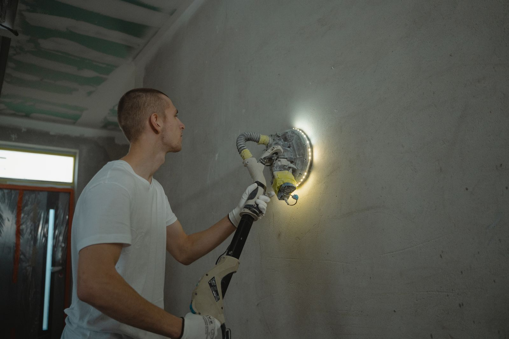

Two painters walk your house. One quotes $2,400, one quotes $1,300. The paint costs the same at the
store. The rooms are the same size. So where did $1,100 go?

Almost always: prep. Prep is the part you cannot see once the job is done, it is the part that
decides whether the finish lasts three years or twelve, and it is the easiest line to quietly delete
from a bid. This post is about how to tell the difference before you sign, not eighteen months later
when the trim starts letting go.

## The core fact, from the federal technical literature

The National Park Service publishes a technical brief on exterior paint failure. It is written for
historic woodwork, but the adhesion science is the same on your hallway. The key sentence:

> "paint can adhere just as effectively to existing paint as to bare wood, providing the previous
> coats of paint are also adhering uniformly and tightly to the wood and the surface is properly
> prepared for repainting: cleaned of dirt and chalk and dulled by sanding."

Read what that actually says. **You usually do not need to strip anything.** What you need is a
surface that is clean, sound and dull. Three conditions. Every one of them is a labor hour, and every
one of them is invisible in the finished job.

The same brief is blunt about what happens when you skip it. On peeling: "There is no sense in
repainting before dealing with the moisture problems because new paint will simply fail."

## What actually causes paint to fail

Here is the failure table. This is the diagnostic your painter should be running before quoting, not
after.

| What you see | What it usually is | What it means for the quote |
|---|---|---|
| Peeling down to bare substrate | Moisture behind the film breaking adhesion at the bottom layer | Find and fix the water source first. Painting over it is money set on fire |
| Peeling that stops at another layer of paint | Intercoat failure. Dirty surface, or incompatible paint over paint | Wash, sand, and prime with the right primer |
| Latex peeling off in sheets from old glossy paint | Latex applied over old chalking oil paint, which it "is unable to penetrate ... and adhere" | Oil based primer first, or the new coat comes off |
| Fine cracking in a web pattern | Crazing, aging film that has lost flexibility | Sand and repaint. Catch it here and it stays cheap |
| Deep cracking, alligator pattern | Advanced crazing plus moisture through the cracks | This is now a removal job, not a repaint |
| Wrinkled, sagging film | Applied too thick, or recoated before the first coat dried, or "inadequate brushing out" | An application error. Somebody rushed |
| Small blisters with paint underneath | Solvent blistering, from painting in direct sun | Application error. Not a moisture problem |
| Blisters with bare substrate underneath | Moisture | Different problem, different fix |
| Black or gray speckling in damp corners | Mildew, which needs "shady, warm, moist areas" to live | Kill it and fix the moisture, or it comes straight back through |

Sources: National Park Service Preservation Brief 10.

There is a genuinely useful field test in there for the last one. If you cannot tell mildew from
dirt, put a drop of household bleach on it. "Mildew will immediately turn white whereas dirt will
continue to look like dirt." That takes four seconds and it changes the whole scope.

## The diagram: same wall, two jobs

<figure class="chart">
<svg viewBox="0 0 720 360" role="img" aria-labelledby="p2t p2d" style="width:100%;max-width:720px;height:auto">
  <title id="p2t">Cross-section of a prepared repaint versus an unprepared repaint</title>
  <desc id="p2d">On the left, a wall that was washed, sanded, patched, primed and given two finish coats bonds through every layer. On the right, new paint applied over dirt, chalk and a glossy old coat has nothing to key into, so the new film lifts away.</desc>
  <g font-family="system-ui, sans-serif" fill="currentColor">

    <text x="10" y="22" font-size="14" font-weight="600">Prepared</text>
    <text x="10" y="40" font-size="12" opacity="0.7">washed, sanded dull, patched, primed, two coats</text>
    <rect x="10" y="200" width="320" height="90" fill="#b9a789"></rect>
    <text x="20" y="250" font-size="12" fill="#3a3220">Substrate (drywall or wood)</text>
    <rect x="10" y="188" width="320" height="12" fill="#8a8f98"></rect>
    <rect x="10" y="172" width="320" height="16" fill="#5f92c9"></rect>
    <rect x="10" y="156" width="320" height="16" fill="#1f5fa9"></rect>
    <line x1="340" y1="194" x2="380" y2="194" stroke="currentColor" stroke-width="1" opacity="0.5"></line>
    <text x="336" y="130" font-size="12" text-anchor="start">Coat 2</text>
    <text x="336" y="150" font-size="12" text-anchor="start">Coat 1</text>
    <text x="336" y="170" font-size="12" text-anchor="start">Primer</text>
    <line x1="10" y1="200" x2="330" y2="200" stroke="#2e7d4f" stroke-width="3" stroke-dasharray="6 4"></line>
    <text x="14" y="320" font-size="12" fill="#2e7d4f">Green line: the sanded, cleaned, dulled surface. That is the bond.</text>

    <text x="400" y="22" font-size="14" font-weight="600">Not prepared</text>
    <text x="400" y="40" font-size="12" opacity="0.7">one thick coat straight over dirt and gloss</text>
    <rect x="400" y="200" width="310" height="90" fill="#b9a789"></rect>
    <text x="410" y="250" font-size="12" fill="#3a3220">Substrate (drywall or wood)</text>
    <rect x="400" y="190" width="310" height="10" fill="#c8b89a"></rect>
    <rect x="400" y="180" width="310" height="10" fill="#9aa3ad"></rect>
    <path d="M400 156 L640 156 L640 180 L400 180 Z" fill="#1f5fa9"></path>
    <path d="M640 156 L700 156 C700 156 692 132 668 138 C650 142 648 152 640 156 Z" fill="#c0392b"></path>
    <text x="400" y="320" font-size="12" fill="#c0392b">Red: the new film lifting. Nothing underneath it was cleaned or dulled.</text>
    <text x="400" y="338" font-size="12" opacity="0.7">Gray band: old glossy coat. Tan band: dirt and chalk left in place.</text>
  </g>
</svg>
<figcaption>Adhesion is a surface condition, not a paint quality. Principle drawn from National Park Service Preservation Brief 10.</figcaption>
</figure>

## Why "we include free prep" is not a real sentence

Look at the published labor rates.

| Trade | Published labor rate |
|---|---|
| Drywall repair | from $75 per hour |
| Interior painting, specialty | $75 per hour and up |
| Interior painting, general | $30 to $60 per hour, averaging around $60 |
| Wallpaper removal | $35 to $79 per hour, averaging $58 |

Sources: Thumbtack drywall repair cost, Thumbtack cost to paint a room, This Old House interior
painting cost, Thumbtack wallpaper removal cost.

**Prep hours bill higher than brush hours.** So when a bid is dramatically cheaper, one of two things
is true. Either the prep is not in there, or it is in there at a price that guarantees it gets rushed
on the day. Neither one is a discount. It is a smaller job wearing the same words.

The honest version is that prep is scoped and stated. On a clean, sound, recently painted room, prep
is genuinely light and the price should reflect that. On a 1968 house with nail pops, tobacco
staining, a wallpapered dining room and enamel trim from the Carter administration, it is not light,
and pretending otherwise is how you get a callback in year two.

## The twelve-point walk-through, in order

This is the sequence. If a contractor is not doing most of it, they are not preparing, they are
covering.

1. **Find the water first.** Stains on a ceiling, a cold corner, a bathroom with no working fan.
   Paint does not fix water and water destroys paint.
2. **Wash.** Kitchens carry grease, everything carries dust, bathrooms carry soap film. Nothing bonds
   to a film of anything.
3. **Scrape what is loose.** To the next sound layer. Not to bare wood as a reflex.
4. **Patch and fill.** Nail pops set and refilled, corner bead dents, cracks cut out rather than
   skimmed over.
5. **Sand.** Two purposes: flatten the patches, and dull the existing sheen so the next coat has
   something to key into.
6. **Caulk.** Trim to wall, casing joints, baseboard to wall. This is most of what makes a job look
   sharp, and it is fast to skip.
7. **Spot prime.** Every patch, every bare spot, every stain. Unprimed patches flash through the
   finish and you will see them at an angle for the life of the job.
8. **Full prime where it is needed.** Bare drywall, big color change, and any latex going over old
   oil or chalky paint.
9. **Deal with bleed-through properly.** For tannin bleed and heavy stains, the NPS brief recommends
   two primer coats for severe cases, with each coat "allowed to dry at least 48 hours." That is a
   schedule item, not an afternoon.
10. **Mask and cover.** Floors, fixtures, furniture. Drop cloths, not newspaper.
11. **Two coats, brushed or rolled out properly.** Applying too thick and recoating before the first
    coat has dried are two of the four named causes of wrinkling.
12. **Cut-in and lines.** Straight lines are the last five percent of the labor and the first thing
    every visitor sees.

<figure>
  
  <figcaption>Sanding does two jobs at once: it flattens the patches and it kills the sheen so the next coat can bond. Stock photo, to be replaced with our own job photos.</figcaption>
</figure>

## Nine questions to ask, and the answers that should worry you

| Ask this | A good answer sounds like | A bad answer sounds like |
|---|---|---|
| "How many coats, and is primer separate?" | "Two finish coats. Primer on patches and on the trim, and full prime in the dining room because of the color change." | "Two coats." Full stop |
| "What are you doing about the nail pops?" | "Set them, fill twice, sand, spot prime." | "The paint will cover it" |
| "Is this trim oil or latex?" | "Let me check with a solvent rag." | Shrug |
| "What primer, by name?" | A specific product for the specific problem | "Whatever they have" |
| "How are you handling the wallpaper in the back room?" | Removal, adhesive wash, skim, prime | "We can paint right over it" |
| "The house is from 1970. What is your EPA lead-safe firm certification number?" | A number, given without hesitation | "That is not really a thing for painting" |
| "How long between coats?" | A time, tied to the product data sheet and the room conditions | "We do it all in one day" on a job that cannot be done in one day |
| "Who moves the furniture and who covers the floors?" | A clear answer either way, in the quote | "We will figure it out" |
| "What is not included?" | A real list | "Everything is included" |

That sixth one deserves a note. The EPA requires that anyone paid to disturb painted surfaces in
homes built before 1978 be certified, and states that this "includes all firms, even sole
proprietorships." The median house in Bridgeview was built in 1975, in Oak Lawn 1967, in Burbank
1965, in Evergreen Park 1955. In this area, that question is not a technicality. It applies to most
of the housing.

## One more thing: paint has a thickness limit

This surprises people. From the same NPS brief: when paint builds up to about 1/16 of an inch,
roughly 16 to 30 layers, "one or more extra coats of paint may be enough to trigger cracking and
peeling." Thick paint fails at its weakest point, which is the oldest layer against the wood.

On interior trim in a house that has been repainted every decade since 1965, that is a real
condition. It is why heavy old trim sometimes needs stripping rather than another coat, and it is why
a painter who looks closely at your casing before quoting is doing you a favor even if the number
goes up.

## The short version

- Almost all paint failure is moisture or surface preparation, not the paint.
- Clean, sound and dull. That is the whole standard, and each word is billable labor.
- Prep hours cost more than brush hours, so the cheap bid is a smaller job, not a better deal.
- Ask for the prep scope in writing and ask what is excluded.
- On any pre-1978 house here, ask for the EPA lead-safe firm certification number.

We are in Bridgeview at 7900 W. 83rd St. If you want somebody to actually look at the walls before
putting a number on them, call **[708-935-4289](tel:+17089354289)**.

More on this: [interior painting](../interior-painting.html) and
[drywall repair and painting](../drywall-and-repair.html). For what the numbers look like, read
[what interior painting costs in the southwest suburbs](interior-painting-cost-southwest-chicago-suburbs.html).
For the outside of the house, read
[exterior painting in the Chicago climate](best-time-to-paint-house-exterior-chicago.html).

## References

1. National Park Service, Preservation Brief 10: Exterior Paint Problems on Historic Woodwork. https://www.nps.gov/orgs/1739/upload/preservation-brief-10-paint-problems-exterior-woodwork.pdf
2. National Park Service, Preservation Briefs index. https://www.nps.gov/orgs/1739/preservation-briefs.htm
3. Thumbtack, Drywall Repair Cost. https://www.thumbtack.com/p/drywall-repair-cost
4. Thumbtack, Cost to Paint a Room. https://www.thumbtack.com/p/cost-to-paint-a-room
5. Thumbtack, Wallpaper Removal Cost. https://www.thumbtack.com/p/wallpaper-removal-cost
6. This Old House, Interior Painting Cost. https://www.thisoldhouse.com/painting/reviews/interior-painting-cost
7. U.S. Environmental Protection Agency, Lead Renovation, Repair and Painting Program. https://www.epa.gov/lead/lead-renovation-repair-and-painting-program
8. U.S. Census Bureau, American Community Survey 5-year estimates, 2023, table B25035. https://www.census.gov/programs-surveys/acs
