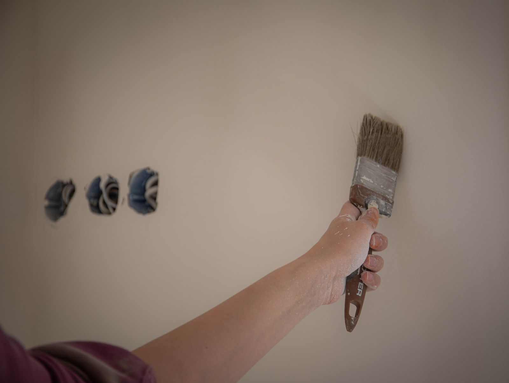

Almost nobody in this market publishes a price. You call five painters, you get five numbers, and
nothing explains why one of them is triple another one. That is not a coincidence and it is not a
scam. It is that "paint a room" describes about six different jobs.

This post does two things. It shows you the published market ranges from national cost publishers so
you have a starting frame. Then it explains the six things that decide where inside that range your
house lands, which is the part that actually helps you read a quote.

**One thing up front, because it matters.** Every dollar figure below is a published range from a
national cost source, named and linked at the bottom. None of it is our price. We quote a job after
walking it, because that is the only honest way to price work you have not seen. If a contractor
gives you a firm number over the phone without looking at the house, they are either guessing high
to protect themselves or guessing low to get in the door.

## The published ranges, by room

| Room | Typical range |
|---|---|
| Half bath | $50 to $150 |
| Master bath, about 70 sq ft | $350 to $650 |
| Bedroom, about 132 sq ft | $300 to $800 |
| Kitchen | $200 to $750 |
| Dining room, 300 to 400 sq ft | $600 to $1,000 |
| Living room, about 340 sq ft | $600 to $2,000 |

Source: This Old House, interior painting cost.

Read the living room line again. **Six hundred dollars to two thousand dollars, on the same nominal
room.** That is a 3.3x spread, and nothing about the paint explains it. That gap is the whole subject
of this post.

A second publisher puts one room, all in, at $364 to $965 with a most common figure around $593, and
prices the work at $0.81 to $1.35 per square foot for seal, prime and two coats. On a 400 square foot
room that is $324 to $540. On a 1,200 square foot open area it is $972 to $1,620.

## Where the money actually is: it is not the walls

Here is the part most homeowners get wrong. When you picture a paint job you picture walls. The
published averages say the walls are the cheapest part of the room.

<figure class="chart">
<svg viewBox="0 0 720 300" role="img" aria-labelledby="c1t c1d" style="width:100%;max-width:720px;height:auto">
  <title id="c1t">Average interior painting cost by surface</title>
  <desc id="c1d">Walls average $700, ceilings $850, trim $940, doors $1,000 and window frames $1,100, according to Thumbtack's interior painting cost page.</desc>
  <g font-family="system-ui, sans-serif" font-size="14" fill="currentColor">
    <text x="0" y="20" font-size="13" opacity="0.7">Average cost per interior job, by surface (Thumbtack)</text>

    <text x="0" y="66" text-anchor="start">Walls</text>
    <rect x="150" y="52" width="280" height="24" fill="#1f5fa9"></rect>
    <text x="440" y="70" font-size="13">$700</text>

    <text x="0" y="106" text-anchor="start">Ceilings</text>
    <rect x="150" y="92" width="340" height="24" fill="#1f5fa9"></rect>
    <text x="500" y="110" font-size="13">$850</text>

    <text x="0" y="146" text-anchor="start">Trim</text>
    <rect x="150" y="132" width="376" height="24" fill="#1f5fa9"></rect>
    <text x="536" y="150" font-size="13">$940</text>

    <text x="0" y="186" text-anchor="start">Doors</text>
    <rect x="150" y="172" width="400" height="24" fill="#1f5fa9"></rect>
    <text x="560" y="190" font-size="13">$1,000</text>

    <text x="0" y="226" text-anchor="start">Window frames</text>
    <rect x="150" y="212" width="440" height="24" fill="#1f5fa9"></rect>
    <text x="600" y="230" font-size="13">$1,100</text>

    <line x1="150" y1="248" x2="640" y2="248" stroke="currentColor" stroke-width="1" opacity="0.35"></line>
    <text x="150" y="266" font-size="12" opacity="0.7">$0</text>
    <text x="350" y="266" font-size="12" opacity="0.7">$500</text>
    <text x="550" y="266" font-size="12" opacity="0.7">$1,000</text>
  </g>
</svg>
<figcaption>Trim and doors together average about $1,940 against $700 for walls. Source: Thumbtack, interior painting cost.</figcaption>
</figure>

Trim and doors together average roughly **2.8 times what walls average**. Trim is billed by the
linear foot, commonly $1 to $3 per foot inside, with doors at $40 to $100 each and stairways at $15
to $30 per linear foot.

This is why a 1960s Bridgeview or Oak Lawn ranch with heavy casing, six panel doors, full baseboard
runs and a wood staircase is a completely different job from a newer open plan house with the same
floor area and almost no trim in it. Same square footage. Not the same job. Not the same price.

**The practical takeaway:** when you get a quote, find out what is included. "Paint the living room"
can mean walls only, or walls plus ceiling, or walls plus ceiling plus trim plus doors plus window
frames. That single ambiguity is most of the difference between two quotes you thought were
comparable.

## Why two national publishers disagree by 2x on a whole house

| Whole interior, 2,000 sq ft home | Published figure |
|---|---|
| This Old House | $2,000 to $8,000 |
| Thumbtack, at $4.51 to $7.53 per sq ft | $9,020 to $15,060 |

These are not both wrong. They are measuring different jobs. The lower figure is closer to walls
only. The higher figure is closer to walls, ceilings, trim, doors and frames with real prep. Same two
words on the estimate, roughly double the work.

## The six things that move your number

### 1. Prep condition

This is the largest single variable and the one you can see least. Patched drywall, nail pops,
nicotine staining, old wallpaper adhesive, chalky plaster and peeling enamel all add hours before a
finish coat goes anywhere.

The rate data makes the point. Drywall repair labor starts around $75 an hour. General interior
painting labor averages around $60. Textured surfaces carry a stated uplift of $0.50 to $1 per square
foot. **Prep hours cost more than brush hours**, which is exactly why a cheap quote is usually a
quote with the prep taken out of it. There is a whole post on how to spot that:
[how to tell good prep from a fast cheap job](how-to-tell-good-prep-from-a-fast-cheap-job.html).

### 2. Coats, and whether you are changing color

The per square foot figures above assume two coats. Going dark to light, or into any deep base color,
means a tinted primer plus what is effectively a third coat. That is roughly a fifty percent labor
increase on the finish, and it is the single most common thing homeowners do not expect to pay for.

If your budget is tight, staying within a few shades of what is already on the wall is the cheapest
real decision you can make.

### 3. Ceiling height

A two story foyer, a vaulted great room or a stairwell is not the same room as an eight foot bedroom.
Ladders and staging turn a one person room into a two person room, or a slow room. These should never
be quoted at a flat room rate, and if someone quotes your foyer at bedroom money, ask how they plan
to reach it.

### 4. Trim count and cut-in footage

Covered above. Count your doors before you call anyone. It is the fastest way to predict whether your
quote is going to surprise you.

### 5. Pre-1978 housing and the lead-safe rule

This one is specific to our area and it is not optional.

The EPA Renovation, Repair and Painting rule requires that anyone **paid** to perform work that
disturbs painted surfaces in homes built before 1978 be certified, and the EPA states plainly that
this includes all firms, "even sole proprietorships."

Now look at the housing stock here.

| Town | Median year structure built |
|---|---|
| Evergreen Park | 1955 |
| Burbank | 1965 |
| Oak Lawn | 1967 |
| Worth | 1967 |
| Hickory Hills | 1970 |
| Chicago Ridge | 1973 |
| Alsip | 1974 |
| Bridgeview | 1975 |
| Justice | 1976 |
| Palos Hills | 1977 |

Source: U.S. Census Bureau, American Community Survey 5-year estimates 2023, table B25035.

Every one of those medians is before 1978. That means **more than half the houses in these towns fall
under the rule**, and containment, HEPA vacuuming and cleanup are real, billable hours on those jobs.
A bid that ignores it is cheaper because it is doing less, not because the contractor is more
efficient.

Ask any painter you are considering for their EPA lead-safe firm certification number before work
starts. It is a number. They either have it or they do not.

### 6. Mobilization, which is why one small job prices badly

Every job carries fixed costs that do not scale: the estimate visit, the drive, the setup, the
masking, the cleanup, the invoice. On a five room job those spread across five rooms. On a one room
job they land on one room.

This Old House says it directly: painting multiple rooms does not double the cost, because overhead
spreads across the job. Read backwards, that is why a single small room is the worst value per square
foot you can buy, and why job minimums exist. It is arithmetic, not attitude.

**The move, if you have a small job:** bundle it. If you are having the hallway done, get the two
bedrooms done in the same visit. If we are already in the house for a repaint, adding the drywall
repair or the trim work costs you nothing in setup and nothing in a second trip.

## One more thing that changes the price: textured and popcorn ceilings

Painting a ceiling flat runs about $1 to $2.50 per square foot. Removing popcorn texture and
finishing the ceiling afterward runs roughly $1.80 to $5.50 per square foot once you add removal to
the finish coat. Same ceiling, two to three times the ticket.

Important, and this is the part to take seriously: **popcorn texture in a pre-1980 home is a
test-first job, not a scrape-first job.** Asbestos was used in ceiling texture in that era. The
correct order is test, then decide. Anyone who offers to start scraping your 1972 ceiling on the spot
is telling you something about how they work.

## What a quote should actually itemize

Bring this list to whoever you are getting a bid from.

| Line item | Why it matters |
|---|---|
| Which surfaces are included | Walls only, or walls, ceilings, trim, doors and frames |
| Number of coats, and primer | Two coats is the industry assumption. Color change usually needs more |
| Prep scope, in words | Patching, sanding, caulking, degreasing, wallpaper removal |
| Ceilings over eight feet | Staging and access, priced separately |
| Product and sheen, by name | Interior paint runs roughly $30 to $60 a gallon at the grades worth using |
| Pre-1978 lead-safe handling | Containment and cleanup, and the firm certification number |
| Who moves and covers furniture | A real cost either way |
| Timeline and crew size | Tells you whether the price and the schedule are consistent |

If a quote does not distinguish between those, the two quotes on your kitchen table are not
comparable and you are not choosing on price. You are choosing on wording.

<figure>
  
  <figcaption>Cut-in and trim work is billed by the linear foot, and it is where interior labor concentrates. Stock photo, to be replaced with our own job photos.</figcaption>
</figure>

## The short version

- Walls are the cheap part. Trim, doors and frames are where the labor sits.
- A 3.3x spread on the same room is real, and it is prep, coats, height, trim count and access.
- More than half the houses in this area were built before 1978, and that is a rule, not an upsell.
- Bundling work into one visit is the only reliable way to lower cost per square foot.
- No honest firm number exists until somebody has walked the job.

We are based at 7900 W. 83rd St. in Bridgeview and we quote interior work across the southwest
suburbs. If you want a number for your actual house instead of a national average, call
**[708-935-4289](tel:+17089354289)**.

More on this: [our interior painting work](../interior-painting.html) and
[drywall repair and painting](../drywall-and-repair.html), which is where most of the prep hours
go. If you are weighing a kitchen, read
[cabinet refinishing versus replacing](cabinet-refinishing-vs-replacing.html).

## References

1. This Old House, Interior Painting Cost. https://www.thisoldhouse.com/painting/reviews/interior-painting-cost
2. Thumbtack, Interior Painting Cost. https://www.thumbtack.com/p/interior-painting-cost
3. Thumbtack, Cost to Paint a Room. https://www.thumbtack.com/p/cost-to-paint-a-room
4. Thumbtack, Drywall Repair Cost. https://www.thumbtack.com/p/drywall-repair-cost
5. Thumbtack, Popcorn Ceiling Removal Cost. https://www.thumbtack.com/p/popcorn-ceiling-removal-cost
6. U.S. Environmental Protection Agency, Lead Renovation, Repair and Painting Program. https://www.epa.gov/lead/lead-renovation-repair-and-painting-program
7. U.S. Environmental Protection Agency, Protect Your Family from Sources of Lead. https://www.epa.gov/lead/protect-your-family-sources-lead
8. U.S. Census Bureau, American Community Survey 5-year estimates, 2023, table B25035, retrieved via the Census Data API. https://www.census.gov/programs-surveys/acs

*Cost figures cited above were published by the named sources and retrieved on August 31, 2026. They
are national market ranges, not a quote, and not our prices.*
