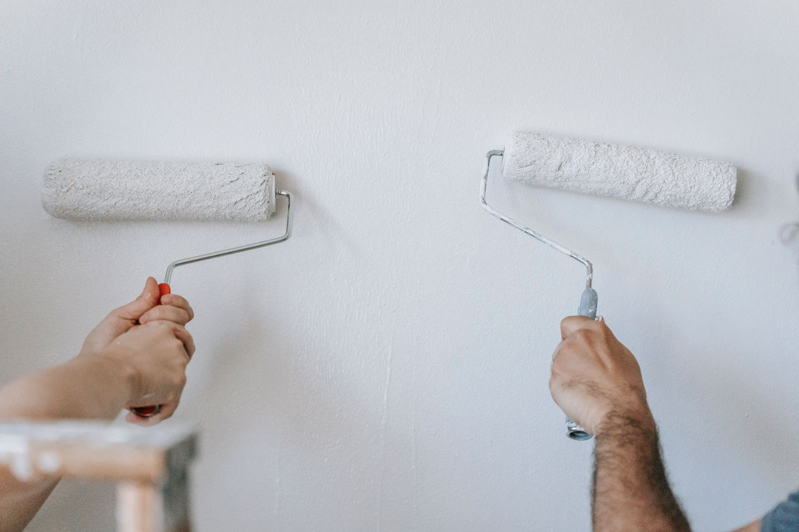

Every landlord we talk to has the same instinct on turnover painting: get it cheap. That is the wrong
variable. The expensive thing about a turnover is not the paint. It is the days.

Here is the arithmetic, using real local rent data instead of a guess.

## What a vacant day costs here

| Town | Median gross rent | Renter households | Cost per vacant day |
|---|---:|---:|---:|
| Alsip | $1,102 | 2,709 | $36 |
| Hickory Hills | $1,112 | 1,585 | $37 |
| Bridgeview | $1,139 | 2,146 | $37 |
| Worth | $1,164 | 1,517 | $38 |
| Chicago Ridge | $1,198 | 2,391 | $39 |
| Justice | $1,198 | 2,329 | $39 |
| Burbank | $1,241 | 1,913 | $41 |
| Palos Hills | $1,267 | 1,496 | $42 |
| Oak Lawn | $1,310 | 3,805 | $43 |
| Evergreen Park | $1,425 | 1,219 | $47 |
| Orland Park | $1,415 | 3,214 | $47 |
| Tinley Park | $1,518 | 2,756 | $50 |

Source: U.S. Census Bureau, American Community Survey 5-year estimates 2023, tables B25064 (median
gross rent) and B25003 (tenure). Cost per vacant day is monthly rent multiplied by 12 and divided by
365, rounded.

The nine towns closest to us hold roughly **19,900 renter-occupied units** between them. Justice is
48 percent renter households. Chicago Ridge is 45 percent. This is not a fringe market out here, it
is a large one.

Median rent across those nine near-ring towns is $1,198, which is about **$39 a day**. Now put that
next to what the work costs.

<figure class="chart">
<svg viewBox="0 0 720 320" role="img" aria-labelledby="p6t p6d" style="width:100%;max-width:720px;height:auto">
  <title id="p6t">Cost of vacancy by number of days, compared to a typical single room repaint</title>
  <desc id="p6d">At the near-ring median rent of $1,198 a month, five vacant days cost about $197, ten days $394, fifteen days $591, twenty days $788 and thirty days $1,182. The published typical cost of a single room repaint is $593, which is roughly what fifteen vacant days cost.</desc>
  <g font-family="system-ui, sans-serif" fill="currentColor" font-size="12">
    <text x="0" y="16" font-size="13" opacity="0.75">Lost rent by vacant days, at the near-ring median of $1,198 a month (about $39 a day)</text>

    <line x1="70" y1="260" x2="700" y2="260" stroke="currentColor" stroke-width="1" opacity="0.4"></line>
    <line x1="70" y1="172" x2="700" y2="172" stroke="currentColor" stroke-width="1" opacity="0.15"></line>
    <line x1="70" y1="85"  x2="700" y2="85"  stroke="currentColor" stroke-width="1" opacity="0.15"></line>
    <text x="30" y="264" opacity="0.7">$0</text>
    <text x="20" y="176" opacity="0.7">$500</text>
    <text x="10" y="89"  opacity="0.7">$1,000</text>

    <line x1="70" y1="156" x2="700" y2="156" stroke="#c0392b" stroke-width="1.5" stroke-dasharray="5 4"></line>
    <text x="440" y="150" font-size="11" fill="#c0392b">$593, published typical cost of a single room repaint</text>

    <rect x="120" y="226" width="70" height="34" fill="#1f5fa9"></rect>
    <text x="155" y="220" text-anchor="middle" font-size="11">$197</text>
    <rect x="230" y="191" width="70" height="69" fill="#1f5fa9"></rect>
    <text x="265" y="185" text-anchor="middle" font-size="11">$394</text>
    <rect x="340" y="157" width="70" height="103" fill="#1f5fa9"></rect>
    <text x="375" y="120" text-anchor="middle" font-size="11">$591</text>
    <rect x="450" y="122" width="70" height="138" fill="#1f5fa9"></rect>
    <text x="485" y="116" text-anchor="middle" font-size="11">$788</text>
    <rect x="560" y="53"  width="70" height="207" fill="#1f5fa9"></rect>
    <text x="595" y="47"  text-anchor="middle" font-size="11">$1,182</text>

    <g text-anchor="middle" opacity="0.85">
      <text x="155" y="280">5 days</text><text x="265" y="280">10 days</text><text x="375" y="280">15 days</text>
      <text x="485" y="280">20 days</text><text x="595" y="280">30 days</text>
    </g>
    <text x="0" y="308" font-size="11" opacity="0.7">Rent data: U.S. Census Bureau ACS 2023. Repaint figure: Thumbtack, cost to paint a room.</text>
  </g>
</svg>
<figcaption>Fifteen vacant days costs roughly what a room repaint costs. Two extra weeks of turnaround is not a saving, it is a second paint job you paid for and did not get.</figcaption>
</figure>

**Fifteen empty days costs about what a room repaint costs.** So a painter who is $200 cheaper and
takes a week longer has cost you money, not saved it. That is the frame the whole rest of this post
sits on.

## The deposit rules, and why your painting invoice is part of them

Turnover painting is not only a maintenance decision here. It is tied to how you handle the security
deposit, and the deadlines are short.

**This is not legal advice. Check your own situation with your attorney, and check whether your
municipality is covered before you rely on any of it.** With that said, two things every landlord in
suburban Cook County should know:

**The Cook County Residential Tenant and Landlord Ordinance** took effect June 1, 2021 and, per the
county, applies to almost all rental units in suburban Cook County. It caps security deposits at 1.5
times monthly rent, requires deposits be held separately from personal accounts, and requires the
deposit be returned within 30 days with an itemized list of deductions. Coverage has exclusions and
some municipalities have their own ordinances, so confirm where your building falls.

**The Illinois Security Deposit Return Act (765 ILCS 710)** requires an itemized statement of damage
and repair cost furnished within 30 days of the tenant vacating, with paid receipts attached or
supplied within 30 days if the initial figures were estimates. If that statement and those receipts
are not furnished as required, the Act says "the lessor shall return the security deposit in full
within 45 days of the date that the lessee vacated the premises." Courts may award twice the deposit
plus court costs and reasonable attorney's fees.

Here is the practical consequence for painting, and it is one most owners miss.

**Ordinary repainting between tenants is generally your cost as the owner. Repairing tenant damage is
a different line.** If you are going to deduct anything from a deposit for wall condition, you need a
paid invoice that separates the two, with the damage described specifically. "Painting: $1,400" does
not do that. This does:

| Line | Amount | Deposit deductible? |
|---|---|---|
| Standard turnover repaint, walls and ceilings, 2 bed unit | $ | No. Ordinary wear |
| Repair and patch, 11 anchor holes and 2 drywall punctures, bedroom 2 | $ | Potentially |
| Stain-blocking primer, water damage from unreported bathroom leak | $ | Potentially |
| Odor sealing, smoke, whole unit | $ | Potentially |

Ask your painter to invoice it that way from the start. Trying to reconstruct it after the fact,
inside a 30 day window, is how deductions get thrown out.

## The turnover sequence, and what actually runs in parallel

Most turnovers are slow because they are run in a straight line when they do not have to be.

| Stage | Typical order | Can it overlap? |
|---|---|---|
| 1. Walk-through and photo documentation | Day of move-out | No. This has to be first |
| 2. Trash-out and haul | Day 1 | No |
| 3. Repairs: drywall, doors, trim, hardware | Day 1 to 2 | Partly, by room |
| 4. Clean | After repairs | No, dust kills paint |
| 5. Prime and paint | Day 2 to 4 | Yes, room by room while other rooms are still in repair |
| 6. Floors: refinish, replace or deep clean | After paint | Usually after, so paint drips do not land on new flooring |
| 7. Final clean and punch list | Last | No |
| 8. Photos and listing | Last | **No. Do this the day painting finishes, not the day everything finishes** |

That last row is the free money. **List the unit and start showings the moment the walls are done and
the unit photographs well.** Waiting until the punch list is completely closed before you advertise
adds days to the vacancy that the work did not require.

The other overlap worth building in: get the repairs and the paint from the same trade where you can.
When one person is handling the drywall patching, the door that will not latch, the loose baseboard
and the paint, you lose the two or three days that get burned waiting for a second contractor to show
up. That is the entire argument for a general trades outfit on turnovers rather than a painter alone.

<figure>
  
  <figcaption>Empty units are the fastest painting there is, and the crew size is the variable that controls the calendar. Stock photo, to be replaced with our own job photos.</figcaption>
</figure>

## Run a portfolio spec, not a per-unit decision

If you own more than two units, this is the highest-leverage change available and it costs nothing to
implement.

**Pick one wall color, one ceiling color, one trim color, one sheen, one product line. Write it down.
Use it in every unit.**

What that buys you:

| Benefit | Why it works |
|---|---|
| Touch-up instead of repaint | Same color and same sheen means a scuffed hallway is a twenty minute fix, not a room |
| No color matching | Matching an unknown existing color costs a trip, a sample and a guess |
| Buy in fives | Five gallon buckets instead of gallons, one order, less waste |
| Leftovers are inventory | A half bucket from unit 3 is usable in unit 7 |
| Faster estimates | Your painter is quoting a known scope every time |
| Consistent listings | Every unit photographs the same, which matters more than owners think |

Choosing the spec: a warm off-white or very light greige on walls in eggshell, flat or ceiling-flat on
ceilings, and semi-gloss on trim and doors, is the configuration most portfolios land on for good
reasons. Eggshell washes. Flat hides the patch history on ceilings. Semi-gloss on trim survives
vacuum cleaners.

**One warning on sheen.** Higher sheen shows more of the wall, so an eggshell or satin spec raises
the prep standard on every unit. If your units are older plaster with a long patch history, flat on
walls will look better and cost less than satin will. More on that tradeoff in
[how to tell good prep from a fast cheap job](how-to-tell-good-prep-from-a-fast-cheap-job.html).

## Repaint, touch up, or spot prime and coat

Not every turnover is a repaint. Deciding correctly is worth real money across a portfolio.

| Unit condition | Right move | Roughly |
|---|---|---|
| Clean tenant, under 2 years, few marks, spec color already on the walls | Touch up and clean only | Hours |
| Normal 2 to 4 year tenancy, scuffs and anchor holes, spec color | Spot prime the patches, then one coat on the affected walls | Half a day to a day |
| Long tenancy, marks everywhere, or color is not your spec | Full repaint, walls and ceilings | Multiple days |
| Smoke, pets, water staining, unapproved dark accent walls | Full prep, stain-blocking primer, full repaint | Longest, and price it honestly |
| Wallpaper the tenant put up | Removal first. Published at $0.60 to $1.50 per square foot, typical project $443 to $1,120 | Add days |

The failure mode to avoid is touching up with a different sheen or a slightly different color. It
does not blend, it flashes under the window light, and it looks worse than doing nothing. That is
what the single-spec rule prevents.

## What makes a unit slow, with the published costs

| Problem | Published cost data | Days it adds |
|---|---|---|
| Drywall patching | Labor from $75/hr. One room $444, two rooms $615, three rooms $742, four rooms $1,000, whole house $1,039 | 1 to 2 |
| Specific repairs | 5 ft wall crack $125, 3 ft ceiling crack $150, sand and texture five patches $200, repair a 4 by 8 ft section $225 | Within the above |
| Wallpaper removal | $0.60 to $1.50 per sq ft, typical project $443 to $1,120, labor $35 to $79/hr | 1 to 3 |
| Popcorn ceilings | Removal and finish, roughly $1.80 to $5.50 per sq ft, versus $1 to $2.50 to paint the ceiling flat | Several |
| Smoke and odor | Not published as a separate figure. Sealing primer plus extra coats | 1 to 3 |

Sources: Thumbtack drywall repair, wallpaper removal and popcorn ceiling removal cost pages, This Old
House interior painting cost.

**On popcorn ceilings in a rental, one caution.** Ceiling texture in a pre-1980 building is a
test-first job because of the asbestos question. Do not have anyone scrape it on a turnover schedule
before it has been tested. That is a decision with a much longer tail than a vacant week.

## The rule landlords are explicitly covered by

This is the most important compliance point in the post.

The EPA's Renovation, Repair and Painting rule requires that anyone paid to perform work that
disturbs painted surfaces in housing built before 1978 be certified, and the EPA states this
"includes all firms, even sole proprietorships." **Rental property owners are covered when performing
qualifying work that disturbs paint.**

Now look at the housing stock. The median year built is 1975 in Bridgeview, 1976 in Justice, 1973 in
Chicago Ridge, 1974 in Alsip, 1970 in Hickory Hills, 1967 in Oak Lawn and Worth, 1965 in Burbank and
1955 in Evergreen Park. **The majority of the rental stock in the near ring is pre-1978.**

Two practical consequences:

1. **When you hire out turnover painting on a pre-1978 building, ask for the contractor's EPA
   lead-safe firm certification number.** It is a number. It exists or it does not.
2. **A bid that is dramatically cheaper on a pre-1978 building may be cheaper because it is skipping
   containment and cleanup.** That is not a better price. That is a different job with your name on
   the building.

## What to have ready before the painter walks in

This shortens every turnover and it costs you nothing.

- Unit fully empty, including closets and the garage stall
- Trash-out done
- Utilities on, especially power and heat
- Keys, lockbox code or access arranged in advance, not the morning of
- Your paint spec written down: color, sheen, product, per surface
- A note on anything unusual: the leak in the bathroom ceiling, the anchor holes in bedroom 2, the
  accent wall the tenant added
- Your target list date, so the crew size can be sized to the calendar rather than the other way
  around

## The short version

- At the near-ring median rent, a vacant day costs about $39. Fifteen of them cost about what a room
  repaint costs.
- Speed is worth more than a $200 price difference on almost every turnover.
- Advertise the unit the day the paint is done, not the day the punch list closes.
- One color, one sheen, one product across the whole portfolio. It turns repaints into touch-ups.
- Invoice ordinary repaint separately from tenant damage, because the deposit deadlines are 30 days
  and the penalties are real.
- Most rental stock here is pre-1978. Ask for the EPA lead-safe firm certification number.

Our van says "Maintenance Service" on it, and this is what that means. We are at 7900
W. 83rd St. in Bridgeview and we do turnover painting, patching, trim and door work across the
southwest suburbs. If you have units in Bridgeview, Justice, Chicago Ridge, Worth, Alsip, Burbank,
Hickory Hills, Palos Hills or Oak Lawn, call **[708-935-4289](tel:+17089354289)** and we will talk
about a standing spec and a turnaround you can plan around.

More on this: [interior painting](../interior-painting.html) and
[drywall repair and painting](../drywall-and-repair.html), which is most of what a turnover
actually is. Related reading:
[what interior painting costs in the southwest suburbs](interior-painting-cost-southwest-chicago-suburbs.html).

## References

1. U.S. Census Bureau, American Community Survey 5-year estimates, 2023, tables B25064 (median gross rent), B25003 (tenure) and B25035 (median year structure built), retrieved via the Census Data API. https://www.census.gov/programs-surveys/acs
2. Cook County, Residential Tenant and Landlord Ordinance. https://www.cookcountyil.gov/RTLO
3. Illinois General Assembly, Security Deposit Return Act, 765 ILCS 710. https://www.ilga.gov/Legislation/ILCS/Articles?ActID=2202&ChapterID=62
4. U.S. Environmental Protection Agency, Lead Renovation, Repair and Painting Program. https://www.epa.gov/lead/lead-renovation-repair-and-painting-program
5. Thumbtack, Cost to Paint a Room. https://www.thumbtack.com/p/cost-to-paint-a-room
6. Thumbtack, Drywall Repair Cost. https://www.thumbtack.com/p/drywall-repair-cost
7. Thumbtack, Wallpaper Removal Cost. https://www.thumbtack.com/p/wallpaper-removal-cost
8. Thumbtack, Popcorn Ceiling Removal Cost. https://www.thumbtack.com/p/popcorn-ceiling-removal-cost
9. This Old House, Interior Painting Cost. https://www.thisoldhouse.com/painting/reviews/interior-painting-cost

*Nothing in this post is legal advice. Cost figures are published national market ranges retrieved on
August 31, 2026 and are not our prices.*
